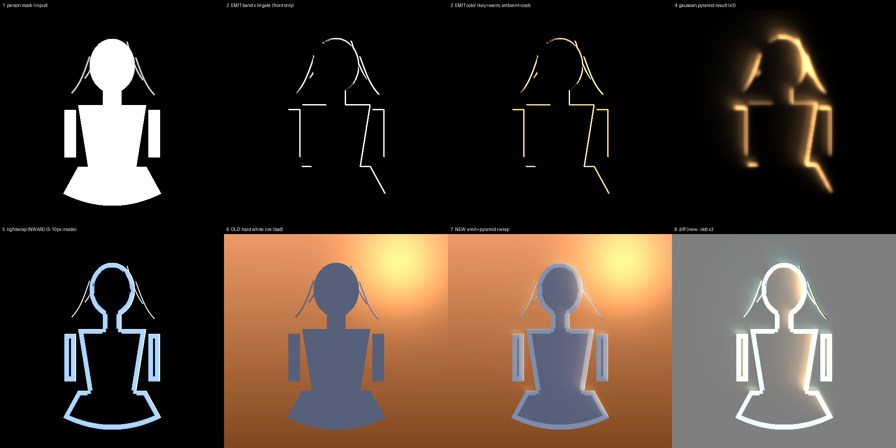

# 边缘光与泛光：从「白描边」到物理光源（v0.26）

> 本文对应 `core-cv/.../gles/GlesLayerPipeline.kt` 里 `FRAG_EMIT` → `FRAG_GAUSS` →
> `FRAG_BLOOM_UP` → `FRAG_GLOW` 四个 pass，以及 `FRAG_LIGHTWRAP` 的重写。
> shader 全文同步在 `docs/shaders/`（由源码抽出，不要手改那边）。

---

## 0. 先诊断：为什么旧实现看起来像描边

旧代码只有一行：

```glsl
c += uRimColor * pow(facing, 1.5) * edgeBand(a) * uRimStrength * uRimIntensity * uRimGain;
```

三个问题叠在一起，**必然**产生白描边，与参数怎么调无关：

| 根因 | 具体表现 |
| --- | --- |
| `edgeBand(a) = smoothstep(0.01,0.15,a)*(1-smoothstep(0.85,0.99,a))` | 这是**固定的 alpha 过渡区**。在二次元线稿上，抠图边缘宽度≈2~3px 且处处相等 → 等宽带 |
| `uRimColor` = 背景高光**中位色** | 阴天/白墙/雪地统计出来就是 `(252,250,247)`，接近纯白 → 白描边 |
| `+=` 之后直接 clamp，没有任何扩散 | 光完全"贴在边上"，不可能有体积，也不可能渗进背景空气 |

所以这次不是调参，而是**换模型**。

---

## 1. 方案总览

```
P2（人物调色）──┐
                ├─► EMIT（1/2 域）     边缘环带 × 主光色 × 迎光门控  → 发光源图
                │
                ├─► GAUSS ×2 / 级      5-tap 可分离高斯，逐级降采样
                │
                ├─► BLOOM_UP ×(N-1)    3×3 tent 上采样 + 累加 → 多尺度光晕
                │
P2C（阴影）──┐  │
BgBlur ──────┼──┴─► LIGHTWRAP（全分辨率）  向内 5~10px 渗透
             │
P1（背景）───┴────► COMPOSITE ──► GLOW（Screen 光晕到整幅画面）──► DOF → GRADE → FXAA
```

关键决定：**泛光在 COMPOSITE 之后 Screen，不在 P2 内部。**

放在 P2 里只能写进人物自己的像素（alpha=0 的背景区根本写不进去），光晕一越过轮廓就断，
观感仍然是"人物内部亮了一圈"。放到合成之后，光才能真正落在背景空气里。

---

## 2. 为什么不用「单个 shader 里做多次高斯」

这是本次最重要的工程判断，先把账算清楚。

**全分辨率可分离高斯的成本**：半径 R ≈ 3σ，需要 `2 × ceil(3σ)` 次纹理采样/像素。

| 需求 | σ | 采样/像素 | 2048² 全图（4.19M px） |
| --- | --- | --- | --- |
| 24px 光晕 | 12 | 73 | **306 M 次** |
| 再叠一层 60px | 30 | 181 | 758 M 次 |

而且这**只做到一个尺度**。想要"锐利核心 + 柔和外晕"的真实衰减曲线，得多尺度叠加 → 成本再乘 N。
中端机 200ms+，不可能进实时管线。

**降采样金字塔的成本**（本实现）：

| 级 | 分辨率 | pass | 采样数 |
| --- | --- | --- | --- |
| L0 | 1024² | H + V（各 5 tap） | 10.5 M |
| L1 | 512² | H + V | 2.6 M |
| L2 | 256² | H + V | 0.7 M |
| L3 | 128² | H + V | 0.2 M |
| UP ×3 | ≤1024² | 3×3 tent（9 tap） | 12.4 M |
| **合计** | | | **≈ 26 M** |

> 默认 `glowSpreadPx = 28`（1080p）→ `plan()` 反解出 **4 级**（1/2 ~ 1/16）。
> 级数不是越多越好：多一级会把局部峰值摊到更大的面积上，结果是"有形状但没亮度"。

**约 11 倍差距，而且拿到的是 4 个尺度。**

一句话记住原理：**大半径模糊靠「降低分辨率」买，不靠「加大核」买。**
1/2 域上 σ=1 的 5-tap，等效于全分辨率 σ=2 的 11-tap；再降一级就是 σ=4……四级叠起来等效
半径 16px，只花了不到一张全图的填充率。降采样时硬件双线性自带低通，连抗锯齿都省了。

> 补充：`uSigma` 恒为 1.0（`GlowPyramid.SIGMA`）。它不是"模糊程度"，只是一个 texel 空间
> 的核宽度；**扩散半径由级数决定**，这由 `GlowPyramid.plan()` 反解 `spread → levels`。

---

## 3. 步骤 ①：提取真实发光源（`FRAG_EMIT`）

三个改动，每个都对着旧实现的一个根因：

### 3.1 环带改用形态学梯度

```glsl
float aMin = 1.0, aMax = 0.0;
for (int i = 0; i < 8; i++) {          // 8 方向 × 半径 uBandPx
    float s = aAt(uv + off_i);
    aMin = min(aMin, s); aMax = max(aMax, s);
}
float band = smoothstep(0.08, 0.55, aMax - aMin);
band *= smoothstep(0.02, 0.25, aMax);  // 确实有人物
```

- 平涂内部：邻域全 1 → 差值 0；
- 远处背景：邻域全 0 → 差值 0；
- **只有轮廓上 alpha 发生 0→1 跨越 → 差值≈1**。

好处是宽度由 `uBandPx` 显式控制（不再被抠图边缘质量绑架），而且**半透明发丝同样有效**
（0→0.3 也算跨越）。

### 3.2 迎光门控必须是硬的

```glsl
float facing = ll > 0.15 ? dot(nOut, lxy / ll) : 0.35;
float lit    = smoothstep(0.0, 0.35, facing);   // facing ≤ 0 严格归零
```

旧版用 `max(0, dot)`：在轮廓上 dot 恒为小的正值 → **全周都在发光**。
规格要求"背光面直接剔除"，所以 `smoothstep` 的下界必须是 0。

⚠️ 另一个老坑：光源接近正顶光时 `uLightDir.xy ≈ 0`，2D 外法向点积恒为 0 → 边缘完全不出光。
所以加了 `ll > 0.15` 的兜底：无方向光时按各向同性给 0.35。

### 3.3 不乘 alpha

```glsl
float outer = 1.0 - smoothstep(0.05, 0.5, a);
float sideW = mix(1.0, 0.62, outer);     // 内侧 1.0 / 外侧 0.62
```

乘 alpha 会把光锁死在人物内部——只能变亮，不能溢出。真实发光的能量是**向外辐射**的，
所以外侧保留 62%，让光晕自然越过轮廓渗进背景空气。这是"发光"与"描边"的分水岭。

### 3.4 颜色：不要用纯白（CPU 侧 `EmissiveColor`）

背景最亮 5% 的均值经常就是 `(252,250,247)`。`EmissiveColor.sanitize()` 做两件事：

1. **压亮**：最亮通道压到 235 以下 —— 边缘光是散射产物，物理上到不了光源白点；
2. **补色度**：chroma < 20 时，沿**环境色的色相方向**补彩度（环境色也是灰轴则退回暖调）。

效果：阴天自动得到"暖白偏橙"，夜景自动得到"冷白偏青"，永远跟着场景走。
这段逻辑在 CPU 上算一次（4 个通道的算术），不进 shader —— 2048² 上跑 400 万次分支是纯浪费，而且没法单测。

---

## 4. 步骤 ②：多次高斯（`FRAG_GAUSS` + `FRAG_BLOOM_UP`）

### 4.1 可分离高斯，5 次采样等效 9 抽头

```glsl
vec2 d = uDir * uTexel * max(uSigma, 0.5);
vec3 c  = texture(uTex, uv).rgb * 0.2270270270;
c += (texture(uTex, uv + d*1.3846153846).rgb
    + texture(uTex, uv - d*1.3846153846).rgb) * 0.3162162162;
c += (texture(uTex, uv + d*3.2307692308).rgb
    + texture(uTex, uv - d*3.2307692308).rgb) * 0.0702702703;
```

权重和 = `0.2270 + 2×0.3162 + 2×0.0703 = 1.0000`，**不需要再除权重和**（这是很多实现里
画面莫名偏暗一半的原因）。这个核来自 GPU Gems 3 ch.40 的线性采样技巧：一次 `texture()`
取两个相邻 texel 的加权和，9 个采样点压成 5 次 fetch。

两个独立的 program（H 与 V），而不是在一个 pass 里循环两个方向——因为乒乓纹理的写目标
必须是另一个 FBO，同 pass 读写同一张纹理是未定义行为。

### 4.2 降采样与 H 模糊合并

第 i 级的 H pass **目标就是第 i 级的尺寸**（更小），采样用源纹理的 texel：

```kotlin
draw(programs["gauss"], fboH, lv.w, lv.h) {     // 目标 = 更小的一级
    uni2f("uTexel", 1f / srcW, 1f / srcH)       // 采样用源的 texel
    uni2f("uDir", 1f, 0f)
}
```

一步完成"降采样 + 半程高斯"，省掉独立的 downsample pass（也省一张中间纹理）。
双线性在 2:1 缩放时正好 4 抽头平均，天然低通。

### 4.3 上采样用 tent，不用裸双线性

```glsl
vec3 s = texture(uLow, uv).rgb * 4.0;
s += axis4 各 * 2.0;      // 上下左右
s += corner4 各 * 1.0;    // 四角
s /= 16.0;
fragColor = vec4(high + s * uWeight, 1.0);   // 累加，不混合
```

裸双线性在 1/8 → 1/4 这种跨 2 倍上采样会留下**可见的方块台阶**（"光晕是马赛克"，与用户最恨
的"方形色块"同源）。3×3 tent 把接缝抹开。9 次采样看着多，但都在低分辨率域，总填充 < 1/4 全图。

`uWeight = 0.85`：越粗的光晕贡献越低。给 1.0 会让整张图被大范围灰雾抬亮；
但给到 0.72 又太少（实测最粗两级几乎看不见，光晕"有形状但没亮度"）。0.85 是这两者的折中。

累加而不是逐级混合，是为了让**所有尺度同时存在**：小尺度给锐利核心，大尺度给柔和外晕。
单一尺度再怎么调，都只是"一个模糊的圆"。

---

## 5. 步骤 ③：Screen 到整幅画面（`FRAG_GLOW`）

```glsl
float w = mix(uAirRatio, 1.0, smoothstep(0.05, 0.55, a));   // 背景 35% / 人物 100%
vec3 add = clamp(gl * uStrength * w, 0.0, uClamp);          // uClamp = 0.85
vec3 c = 1.0 - (1.0 - base) * (1.0 - add);                  // Screen
```

- **Screen 而不是 Add**：Screen 对已经很亮的像素几乎不再抬升（`1-(1-b)(1-s)`），
  白衬衫/高光瞳孔不会被推成死白；Add 叠多层必然烧成一片。
- **背景只给 35%**：规格要求"微微渗透"，人物上给满。
- `uClamp = 0.85`：极端参数下的硬保险，物理上不存在"单次注入 1.5 倍光"。

---

## 6. 光包裹：方向反过来（`FRAG_LIGHTWRAP`）

旧版 `dilate(mask, 5px)` 把蒙版**外扩**，再乘一个"遮罩上升沿"——效果必然是在轮廓外画一圈。
**方向反了。**

真实的光包裹是背景光穿透人物边缘最外层 5~10px 的次表面，越往里越弱。所以：

```glsl
if (a < 0.02) { fragColor = vec4(0.0,0.0,0.0,1.0); return; }   // 背景完全不参与

// 8 方向 × 3 半径的 alpha 探针
float prox = 1.0;
for (int i = 0; i < 8; i++)
  for (int k = 1; k <= 3; k++)
    prox = min(prox, aAt(uv + dir_i * (uWrapPx * k/3.0)));
float depth = 1.0 - prox;      // 贴轮廓 → 1；深入内部 → 0

float inside   = smoothstep(0.45, 0.80, a);   // ★ 严格人物内部，越过轮廓即 0
float wrapMask = pow(depth, 1.8) * inside;    // pow 把权重压到最外 5~10px
```

- `pow(depth, 1.8)`：线性衰减会让整个人物发亮（像罩了层雾），1.8 次方只在最外一圈生效。
  这同时也吃掉了凹角处探针斜穿出去造成的偏大误差。
- 早退分支很值钱：背景通常占画面 50%~80%，省掉它们的 24 次采样。
- 颜色 = 背景模糊光的**亮度** × 按 `N·L` 插值的冷暖双色。迎光侧夕阳暖橙，背光侧天空冷青
  ——不是"给轮廓染色"，而是两块光确实来自不同方向。
- 遮挡：读 P2-c 的 Multiply 因子，投影盖住处同步衰减（否则阴影里的下摆反而最亮）。

---

## 7. Alpha 锁死的三重保证

规格第 4 条：**所有发光只能改 RGB，绝不能改透明度。**

| 层 | 保证 |
| --- | --- |
| shader | `FRAG_EMIT` / `FRAG_GAUSS` / `FRAG_BLOOM_UP` / `FRAG_GLOW` 的 `fragColor = vec4(rgb, 1.0)` |
| 管线 | 光晕在 **composite 之后** Screen，此时画面已是不透明合成结果，物理上不存在"改 alpha" |
| 测试 | `ShaderAlphaContractTest`：静态检查 4 个 pass 的输出必须是 `1.0`，并禁止 `fragColor = vec4(c, a)` |

`FRAG_P2` 的 `aOut = p.a` 契约不变（腐蚀只用于光效门控，绝不写进输出 alpha）。

---

## 8. 成本与预算

2048 长边（实际工作域，`MAX_TEXTURE_SIDE = 2048`）：

| 项 | 数值 |
| --- | --- |
| 新增填充率 | EMIT 1/4 全图 + 金字塔 ~0.4 全图 + 上采样 ~0.33 全图 + GLOW 1 全图 ≈ **2 张全图** |
| 新增采样 | 全分辨率链 LIGHTWRAP 24 tap（仅人物像素）；GLOW 3 tap |
| 新增纹理 | 金字塔 ~20 MB（13 张小纹理）；GLOW 一张 16 MB |
| 估算耗时（中端机） | +12~18 ms；低端机 `glowSpreadPx` 收到 16px（少一级），+8 ms 左右 |

仍在既有预算内（1080p 端到端 < 5s、拖动 ≥ 30fps）。低端机**不关闭**这条链——它才是防白边的
主功能，只把扩散半径收小。

---

## 9. 调参指南

| 想要 | 改什么 | 位置 |
| --- | --- | --- |
| 光更亮 | `glowIntensity` 1.35 → 1.8 | `DefaultImagePipeline` |
| 光晕更大 | `glowSpreadPx` 28 → 40（级数自动 +1） | 同上 |
| 边缘更"实" | `rimWidthPx`（环带半径），滑杆"边缘光"仍有效 | `LightOverrides.rimStrength` → `edgeGlowStrength` |
| 背景空气更亮 | `glowAirRatio` 0.35 → 0.5 | `DefaultImagePipeline` |
| 向内渗透更深 | `wrapRadiusPx` 5 → 10 | 同上 |
| 完全关掉发光 | `edgeGlowStrength = 0`（管线用 1×1 黑纹理占位，整链跳过） | 参数 |

> ⚠️ 「边缘光」滑杆（0~0.5）现在驱动的是**发光源增益**，不是"描边颜色叠加"。
> 语义没变（0 = 不出光，拉满 = 强发光），但实现从"加一圈"变成"点一个光源再让它扩散"。

---

## 9.5 离线验证：`tools/sim_rim_glow.py`

真机之外唯一能确认"形状对不对"的手段。脚本用 numpy 逐段复刻上面四个 pass
（权重常量、`smoothstep` 边界、探针结构全部与 GLSL 一致），输入是一张带发丝和裙摆的
合成剪影，输出 `docs/rim-glow-sim.png` 八格对照：

| 格 | 内容 | 看什么 |
| --- | --- | --- |
| 1 | 输入 mask | 有发丝（1.2px 线）和曲线裙摆 |
| 2 | **环带 × 迎光门** | 只有右上（迎光）轮廓在亮，左侧全灭 |
| 3 | 发光源色 | 迎光暖橙、半影冷蓝（背光被 `lit=0` 剔除，冷色只在半影可见） |
| 4 | **金字塔结果 ×3** | 从轮廓向外柔和衰减的多层光晕，不是等宽带 |
| 5 | **向内渗透 ×3** | 亮带严格在人物**内侧**，越过轮廓即 0 |
| 6 | 旧版（硬白描边） | 整圈均匀发光、含背光面 —— 这就是被废弃的写法 |
| 7 | 新版合成 | 迎光侧金色发光 + 背景空气微亮 |
| 8 | diff（新−旧） | 差异集中在迎光侧（亮）与背光侧（暗） |



这一步抓到过两个真实缺陷，都不是靠读代码能发现的：
1. **`GlowPyramid.plan` 多算了一级**（曾经 `+1` 做"保险"）→ 最粗一级被推到 1/32，
   峰值摊平到整幅画面；
2. **`uWeight = 0.72` 太小** + `glowIntensity = 0.85` 不足以补偿稀释
   → 光晕"有形状但没亮度"。

两处都已按对照图修正。**改这条链的任何参数后，先重跑这个脚本看图，再上真机。**

```bash
python tools/sim_rim_glow.py     # 依赖 numpy + pillow
```

---

## 10. 验收清单（Debug 通道）

`DebugReport.cycleWrapMode()` 循环 0~8：

| 通道 | 期望 | 异常说明 |
| --- | --- | --- |
| 5 向内渗透带 | 只在人物**内侧** 5~10px 有值 | 出现在轮廓外 → 又变成描边了 |
| 6 阴影遮挡 | 投影覆盖处 < 1 | 全 1 → P2-c 没跑到 |
| 7 发光源图（×2） | **只有迎光侧**轮廓在亮 | 全周均匀 → 迎光门控失效（检查 `uLightDir.xy`） |
| 8 泛光金字塔 | 从轮廓向外柔和衰减 | 出现方块台阶 → tent 上采样有问题 |

另外两条必须肉眼确认：
1. **人物轮廓最外 1~2px 不能变透明**（与背景的过渡应仍是 alpha 合成，而不是"消融"）；
2. **背光面不能有光**（逆光剪影时，只有朝光那一侧有金边）。

---

## 11. 已知局限

- **2D 抠图没有深度**，外法向只有 x/y 两个分量（`N.z` 恒 0）。光源接近正顶光时法向点积
  失去意义，只能按各向同性处理（见 3.2 的兜底）。要真正解决需要深度估计，代价远超收益。
- **向内距离是探针估计，不是精确 SDF**。在锐角/凹角处会偏大，靠 `pow(depth, 1.8)` 压制，
  但没有从根上消除。若将来出现明显的"腋下/发梢过亮"，正确解法是 CPU 侧算一次
  Chamfer 距离场（`core-cv/util/DistanceField.kt` 已有现成实现），代价是多一张单通道纹理。
- **金字塔结果在半分辨率域**，最后 Screen 时被放大。极限放大（4K 出图）下 1/2 域的光晕
  边缘会比人物轮廓略软——这与"发光本身就该软"一致，暂不处理。
